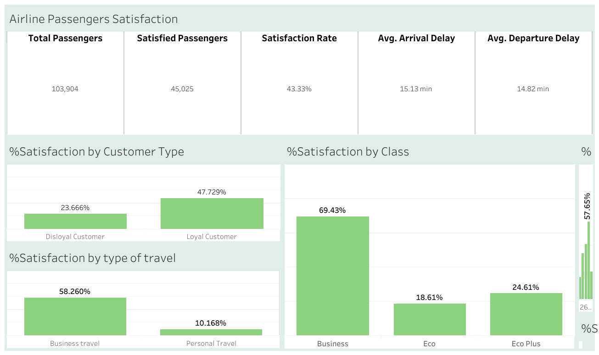

# Airline Passenger Satisfaction Analytics

An end-to-end data analytics project on 100K+ airline passenger survey records. It covers data cleaning with Python, SQL analysis in PostgreSQL, and an interactive Tableau dashboard that shows which passenger segments are satisfied and where service falls short.

**Live dashboard:** [View on Tableau Public](https://public.tableau.com/app/profile/riya.mishra8867/viz/Book2_17953751290950/Dashboard1)



## Business questions
**Overall and segments**
1. What percentage of all passengers are satisfied?
2. How does satisfaction differ by travel class (Business, Eco, Eco Plus)?
3. How does satisfaction differ for loyal vs disloyal customers, split by business vs personal travel?
4. Which age groups are the most and least satisfied?
5. Which combinations of class, travel type, and customer type are the least satisfied?
6. What share of passengers is in each class, and how far is each class from the overall satisfaction average?
**Delays and service quality**
7. Do longer departure delays lower satisfaction?
8. Does delay hurt satisfaction more in some classes than others?
9. Which service ratings (seat comfort, wifi, boarding) differ most between satisfied and unsatisfied passengers?
10. Are passengers who rate seat comfort poorly much less satisfied than those who rate it well?

## Tools
| Area | Tools |
|---|---|
| Data cleaning and exploration | Python, Pandas, Jupyter Notebook |
| Database and SQL analysis | PostgreSQL (Supabase) |
| Visualization | Tableau Public |
| Version control | Git, GitHub |

## Dataset
Airline Passenger Satisfaction survey data from [Kaggle](https://www.kaggle.com/datasets/teejmahal20/airline-passenger-satisfaction): 103,904 passengers, 25 columns.

| Type | Columns |
|---|---|
| Passenger | Gender, Customer Type (Loyal / Disloyal), Age |
| Trip | Type of Travel (Business / Personal), Class (Business / Eco / Eco Plus), Flight Distance |
| Service ratings (0-5) | Inflight wifi, online booking, food and drink, seat comfort, inflight entertainment, cleanliness, and 8 more. A rating of 0 means "not applicable". |
| Delays | Departure and arrival delay in minutes |
| Target | Satisfaction (satisfied / neutral or dissatisfied) |

## Project workflow
1. **Data inspection:** checked structure, data types, missing values, duplicates, and category values.
2. **Data cleaning (Python):**
   - Dropped index and ID columns and renamed columns to snake_case.
   - Handled missing values in arrival delay.
   - Treated service ratings of 0 as "not applicable" rather than a real score.
   - Created features: a binary satisfaction flag, age groups, and departure delay buckets.
3. **SQL analysis (PostgreSQL):** loaded the cleaned data into a table and wrote 10 queries using `GROUP BY`, `CASE`, CTEs, and window functions to answer the business questions.
4. **Dashboard (Tableau):** built KPI cards and charts with filters for class, customer type, and type of travel.

## Key findings
- **43.3%** of the 103,904 passengers are satisfied.
- **Class matters most:** Business class is 69.4% satisfied, compared with 24.6% for Eco Plus and 18.6% for Eco.
- **Travel purpose:** business travelers are 58.3% satisfied, but personal travelers only 10.2%.
- **Loyalty:** loyal customers are 47.7% satisfied vs 23.7% for disloyal customers.
- **Age:** satisfaction peaks at 57.7% for ages 41-60 and is lowest for passengers under 18 (16.4%) and over 60 (20.8%).
- **Delays:** satisfaction falls from 45.8% for on-time flights to 35.7% for delays over 60 minutes, a smaller effect than class or travel type.

These are patterns in survey data and show association, not proof of cause.
## Predictive model
**Goal:** predict whether a passenger will be satisfied, so the airline can flag at-risk passengers early.

**Approach:** one-hot encoded the categorical columns, split the data 80/20 (stratified, `random_state=42`), scaled the features for Logistic Regression, and compared two models on the 20,781 held-out passengers.

| Model | Accuracy | Precision | Recall | F1 |
|---|---|---|---|---|
| Logistic Regression | 0.876 | 0.869 | 0.842 | 0.855 |
| Random Forest | 0.963 | 0.968 | 0.945 | 0.956 |

**Result:** Random Forest performs best, correctly classifying about 96% of passengers. It beats Logistic Regression by roughly 9 percentage points, which suggests satisfaction depends on interactions between factors that a linear model can't capture.

**Key drivers:** online boarding, inflight entertainment, and inflight wifi show the largest rating gaps between satisfied and unsatisfied passengers.

**Limitations:** results come from a single train/test split with default model settings (no cross-validation or tuning), and the model shows association, not causation.

## Dashboard
The Tableau dashboard has:
- KPI cards: total passengers, satisfied passengers, satisfaction rate, average arrival delay, and average departure delay
- Satisfaction by customer type, class, type of travel, age group, and delay
- Filters for class, customer type, and type of travel that update every chart

## Repository structure
```
├── data/          # raw and cleaned datasets
├── notebooks/     # Jupyter notebook: inspection, cleaning, analysis
├── sql/           # PostgreSQL analysis queries
├── dashboard/     # Tableau workbook / screenshots
├── reports/       # figures and dashboard image
└── README.md
```

## How to run
1. Clone the repo: `git clone https://github.com/9056riya/Airline-Passenger-Satisfaction-Analytics.git`
2. Download the dataset from Kaggle and place it in `data/`.
3. Install dependencies: `pip install pandas matplotlib seaborn sqlalchemy psycopg2-binary jupyter`
4. Run the notebook in `notebooks/` to clean the data and create `airline_clean.csv`.
5. Load the cleaned data into PostgreSQL, then run the queries in `sql/`.
6. Open the dashboard from the Tableau Public link above.

## Future improvements
- Add a chart of service-rating factors (wifi, seat comfort, boarding) to show what drives satisfaction.
- Add a predictive model for satisfaction.
- Add an insights panel to the dashboard.

## Author
**Riya Mishra** | [GitHub](https://github.com/9056riya)
